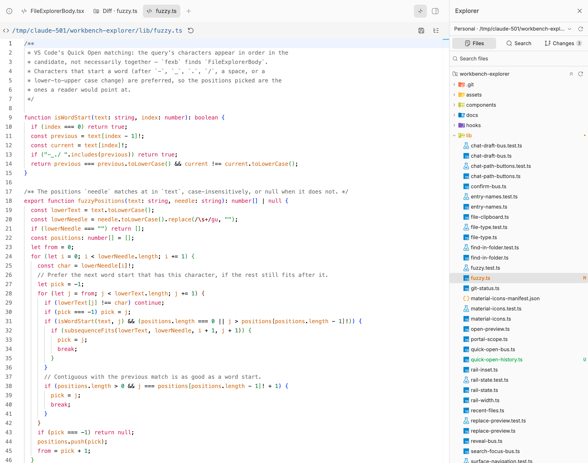

# Workbench Explorer

A VS Code-style file explorer for [BB](https://getbb.app), pinned to the right of the window beside every thread. The tree, BB's own editor tabs and the chat sit side by side, the way an editor's explorer, editor group and panel do.



- **Git at a glance** — files and folders in VS Code's Git colours, a **Changes** tab with every uncommitted file, and diffs in a BB panel tab.
- **Material Icon Theme** — the same file and folder icons as VS Code.
- **Quick Open (⌘E)** — fuzzy file search with recent files and `name:line`.
- **Search and replace (⇧⌘F)** — with an in-place preview of every replacement.
- **Works like an editor's tree** — arrows, F2, Delete, ⌘C/⌘X/⌘V, multi-select, drag and drop, delete to Trash with Undo.

Files open in BB's own editor (the built-in File Editor), so there is nothing new to learn there.

## Install

Search **Workbench Explorer** in BB's plugin store, or:

```sh
bb plugin install git:https://github.com/architawr/bb-plugin-workbench-explorer.git@^0.3.0
```

## Keyboard

| Keys | Where | Does |
|---|---|---|
| ⌘B | anywhere | Show or hide the explorer |
| ⌘E | anywhere | Go to File (Quick Open) |
| ⇧⌘F | anywhere | Search in Files |
| ↑ ↓ ← → Home End | tree | Move; → / ← open and close folders |
| Enter | tree | Open the file, or open/close the folder |
| F2 | tree | Rename in place |
| Delete, ⌘⌫ | tree | Move to Trash (asks first, Undo after) |
| ⌘C ⌘X ⌘V | tree | Copy, cut, paste files |
| ⌘-click, ⇧-click, ⇧↑↓ | tree | Multi-select |

BB keeps ⌘P (its own *Quick open file*) and ⇧⌘E; every key above can be rebound in BB's Settings → Keyboard.

## Layout

- The explorer is a rail on the right of the window, kept across threads. A folder selector pins a project source or a thread workspace; project threads follow their own checkout.
- In BB's desktop window the rail sits below the title bar as a card of its own, and its show/hide button joins the title-bar buttons.
- Drag the rail's left edge to resize it; double-click to reset.
- Paths written in chat get a button that reveals them in the tree, bare file names included.

## Git and icons

- Files and folders take VS Code's Git colours: amber **M** for modified, green **U**/**A** for new, red **D** for deleted, purple **!** for conflicts. A folder holding changes takes the most pressing colour beneath it and ends with a dot. The status is re-read every 3 seconds while the window is visible.
- The **Changes** tab lists every uncommitted file under the pinned folder. Click one for its diff against HEAD in a BB panel tab (Inline or Side by side); **Open** opens the file itself.
- File and folder icons are the [Material Icon Theme](https://github.com/material-extensions/vscode-material-icon-theme) (MIT, see `vendor/material-icon-theme/LICENSE`), resolved the way VS Code does. Regenerate them with `python3 -I scripts/gen-material-icons.py <unpacked material-icon-theme package>`.
- In BB's desktop window the rail sits below the title bar, and its show/hide button joins the title-bar buttons. **Explorer: show or hide** in the command palette toggles it (default ⌘B).

## Finding things

- **Go to File (⌘E)** — VS Code's Quick Open over the pinned folder. Letters in order are enough: `fexb` finds `FileExplorerBody.tsx`, with the matched letters marked. Empty, it lists files opened lately; `server.ts:30` opens on line 30. What git ignores (node_modules, build output) is left out. BB's own ⌘P "Quick open file" is untouched; rebind either in Settings → Keyboard.
- **Search in Files (⇧⌘F)** opens the rail on its Search tab with the query focused. With text in Replace, every result line previews the change: the match struck through, the replacement after it (regex `$1` groups expanded). × dismisses a file so Replace All leaves it alone; result groups collapse one by one or all at once. Replace All says how much will change and asks first.

## Working with files

- **Keyboard:** arrows move and open folders, Enter opens, F2 renames in place, Delete or ⌘⌫ deletes, ⌘C / ⌘X / ⌘V copy, cut and paste. Shift+arrows extend the selection.
- **Selection:** ⌘/Ctrl-click toggles a row, Shift-click selects a range; Cut, Copy, Paste, Duplicate and Delete act on the whole selection.
- **Drag and drop:** onto a folder to move into it, onto a file to move beside it, onto empty space to move to the root. A closed folder opens when held over.
- **Delete goes to the Trash** (macOS, Linux), with an in-app confirmation and an **Undo** in the notification. Machines without a Trash delete permanently and say so.
- **Duplicate and Paste** never overwrite: a taken name becomes `name copy`, `name copy 2`, …
- **Collapse folders** sits beside Reload at the top of the tree.

## Settings

```
bb plugin config workbench-explorer
```

- **Show the pinned file explorer when BB opens** — tree is visible on BB startup (default: on)
- **Confirm before deleting files and folders** — safety dialog before destructive operations (default: on)
- **Show hidden files and folders** — reveal `.git`, `node_modules`, `.claude`, and other build/ignored folders
- **Root folder for personal threads** — set `~/Documents` to offer it as a pinned folder. Project sources and thread workspaces are also available in the folder selector. Project threads always show their project workspace.
- **Files or folders to hide by default** — extra folder names to hide in the tree and search (one per line); extends the built-in skip list (`.git`, `node_modules`, etc.)
- **Folders to search for paths mentioned in chat** — search roots for name-based resolution (default `~/Documents`)

## Develop

```sh
npm install --include=dev
npx tsc --noEmit -p tsconfig.json
bun test
bb plugin build
bb plugin reload workbench-explorer
```

`AGENTS.md` maps the code. Icons are regenerated with `python3 -I scripts/gen-material-icons.py <unpacked material-icon-theme package>`.

## Credits and licence

Workbench Explorer grew out of [bb-plugin-file-explorer](https://github.com/mifhud/bb-plugin-file-explorer) by [mifhud](https://github.com/mifhud), itself based on [bb-plugin-file-tree](https://github.com/fzrx-ego/bb-plugin-file-tree) by [fzrx-ego](https://github.com/fzrx-ego): the rail, the folder picker, chat path reveal and the first search and replace come from them.

MIT — see `LICENSE`. File and folder icons are the [Material Icon Theme](https://github.com/material-extensions/vscode-material-icon-theme), MIT — see `vendor/material-icon-theme/LICENSE`.
